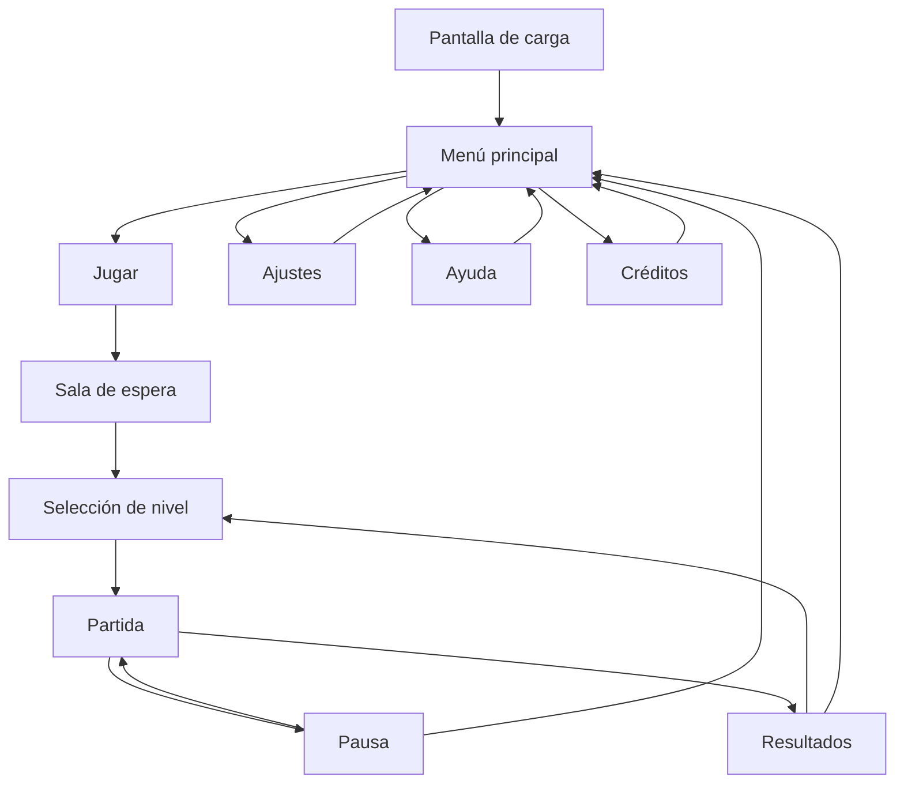

# Super Estrella - Documento de diseño del juego

[Volver al README](README.md)

**Juegos en Red - Grado en Diseño y Desarrollo de Videojuegos - URJC - Curso 2026/27**  
**Grupo:** [NÚMERO DE GRUPO]  
**Autores:** José Antonio Najarro Camacho, Víctor Martín Monterrubio y Daniel Heredia Naranjo  
**Equipo de desarrollo:** [NOMBRE DEL EQUIPO]  
**Repositorio:** https://github.com/Yusuf062/super-estrella

| Nombre y apellidos | Correo URJC | Usuario de GitHub |
| :--- | :--- | :--- |
| José Antonio Najarro Camacho | [CORREO URJC] | Yusuf062 |
| Víctor Martín Monterrubio | [CORREO URJC] | [USUARIO DE GITHUB] |
| Daniel Heredia Naranjo | [CORREO URJC] | [USUARIO DE GITHUB] |

> Los campos entre corchetes deben completarse antes de la entrega. Los nombres de los personajes son provisionales. Las imágenes pendientes deben añadirse a la carpeta `img/` antes de entregar.

## Índice

1. [Introducción](#1-introducción)
2. [Especificaciones básicas](#2-especificaciones-básicas)
3. [Jugabilidad](#3-jugabilidad)
4. [Narrativa](#4-narrativa)
5. [Imagen y diseño visual](#5-imagen-y-diseño-visual)
6. [Sonido](#6-sonido)
7. [Interfaz y diagrama de flujo](#7-interfaz-y-diagrama-de-flujo)
8. [Comunicación y marketing](#8-comunicación-y-marketing)
9. [Referencias](#9-referencias)

---

## 1. Introducción

### 1.1. Concepto del juego

**Super Estrella** es un videojuego cooperativo de plataformas y puzles en 2D para dos jugadores conectados en red. Los protagonistas son Izan y Gael, dos hermanos que recorren una flota de naves espaciales para descubrir qué ocurrió con su padre, el comandante Oris, desaparecido años atrás.

Cada hermano posee una habilidad diferente. Izan domina la tecnología y puede manipular circuitos, mientras que Gael utiliza su fuerza para mover objetos y abrir caminos. Los jugadores deberán comunicarse, coordinar sus movimientos y combinar ambas habilidades para superar obstáculos, activar mecanismos y avanzar por las distintas naves.

La aventura termina con un enfrentamiento contra el comandante Oris, convertido en líder de la flota enemiga. El combate final no se basa únicamente en atacar, sino en resolver un puzle bajo presión para desactivar la armadura y el sistema de control que mantienen al padre enfrentado a sus hijos.

### 1.2. Propuesta de valor

El juego busca ofrecer una experiencia cooperativa sencilla de entender, pero basada en la coordinación real entre dos personas. Sus principales elementos diferenciales son:

- **Habilidades complementarias:** ninguno de los hermanos puede completar la aventura por sí solo.
- **Puzles sincronizados:** algunas acciones deben realizarse al mismo tiempo o en un orden concreto.
- **Cambios de gravedad:** ciertas zonas alteran el movimiento y obligan a reinterpretar el escenario.
- **Narrativa integrada:** las transmisiones, registros y conversaciones entre los hermanos desarrollan el conflicto familiar sin detener constantemente la partida.
- **Jefe final cooperativo:** reutiliza las mecánicas aprendidas durante los niveles en lugar de introducir un sistema de combate completamente distinto.

*Figura 1. Imagen promocional provisional del juego.*

---

## 2. Especificaciones básicas

| Aspecto | Descripción |
| :--- | :--- |
| **Título** | Super Estrella |
| **Género** | Plataformas y puzles cooperativos |
| **Número de jugadores** | 2 jugadores en red y en tiempo real |
| **Público objetivo** | Jugadores de 10 años en adelante, especialmente parejas de amigos o familiares |
| **Clasificación orientativa** | PEGI 7, por violencia fantástica leve y ausencia de contenido explícito |
| **Plataforma** | Navegador web para ordenador |
| **Tecnología prevista** | Phaser 3, HTML, CSS y JavaScript |
| **Duración estimada** | Entre 25 y 40 minutos para completar la aventura |
| **Duración por nivel** | Entre 7 y 12 minutos |
| **Representación** | 2D con vista lateral |
| **Modo de juego** | Cooperativo, no competitivo |
| **Licencia del código** | Apache 2.0 |

---

## 3. Jugabilidad

### 3.1. Objetivo del juego

El objetivo de ambos jugadores es atravesar tres naves, reactivar sus núcleos de energía y alcanzar el puente de mando de la nave capitana. Para superar cada zona, los hermanos deberán llegar juntos a la compuerta de salida después de completar los puzles obligatorios.

La victoria es compartida: los dos jugadores ganan cuando desactivan el sistema de control de Oris y completan la secuencia final. Si uno cae en una trampa, pierde toda su energía o se desconecta, la partida no puede continuar normalmente. En caso de derrota dentro del nivel, ambos reaparecen en el último punto de control activado.

### 3.2. Bucle principal

1. Los jugadores observan la sala e identifican obstáculos, terminales y mecanismos.
2. Deciden qué hermano debe actuar y coordinan el orden de las acciones.
3. Ejecutan el puzle combinando movimiento, saltos y habilidades.
4. Recogen fragmentos de memoria opcionales y activan un punto de control.
5. Alcanzan juntos la salida y avanzan a la siguiente sala o nave.

### 3.3. Controles

Durante la versión local, ambos jugadores podrán compartir teclado. En la versión en red, cada cliente utilizará los controles del jugador 1.

| Acción | Jugador 1 / cliente en red | Jugador 2 en modo local |
| :--- | :---: | :---: |
| Moverse a la izquierda | `A` | `Flecha izquierda` |
| Moverse a la derecha | `D` | `Flecha derecha` |
| Saltar | `W` | `Flecha arriba` |
| Agacharse o descender | `S` | `Flecha abajo` |
| Interactuar / usar habilidad | `E` | `Intro` |
| Reiniciar desde el punto de control | `R` | `Retroceso` |
| Pausa | `Esc` | `Esc` |

### 3.4. Mecánicas principales

- **Movimiento y plataformas:** correr, saltar, agacharse y desplazarse sobre plataformas fijas o móviles.
- **Cooperación:** puertas dobles, interruptores separados y mecanismos temporizados exigen la participación de ambos jugadores.
- **Habilidad de Izan - enlace tecnológico:** activa terminales, cambia el sentido de cintas transportadoras, desactiva barreras de energía y redirige circuitos.
- **Habilidad de Gael - impulso de fuerza:** empuja cajas pesadas, rompe paneles dañados y mantiene palancas que retrocederían al soltarlas.
- **Fragmentos de memoria:** coleccionables opcionales que revelan mensajes del padre y mejoran la puntuación final.
- **Puntos de control:** guardan el progreso dentro del nivel. Deben ser activados por los dos hermanos.
- **Energía:** cada personaje dispone de tres unidades. Los láseres, descargas y golpes eliminan una unidad; caer al vacío provoca reaparición inmediata y resta una unidad.
- **Reanimación:** si un jugador pierde toda su energía, el compañero puede reactivarlo manteniendo la interacción durante tres segundos, siempre que alcance su posición.

### 3.5. Elementos interactivos

| Elemento | Función |
| :--- | :--- |
| Terminal | Izan lo activa para modificar puertas, láseres o gravedad |
| Caja de carga | Gael puede empujarla; sirve de plataforma o contrapeso |
| Placa de presión | Permanece activa mientras un jugador u objeto está encima |
| Palanca sincronizada | Requiere que ambos jugadores interactúen casi al mismo tiempo |
| Plataforma móvil | Transporta jugadores u objetos siguiendo una ruta |
| Cinta transportadora | Aplica movimiento horizontal y puede cambiar de dirección |
| Campo gravitatorio | Reduce, aumenta o invierte temporalmente la gravedad |
| Barrera de energía | Bloquea a Gael hasta que Izan desvíe la corriente |

### 3.6. Físicas y dificultad

El juego utiliza gravedad, velocidad horizontal, salto, colisiones y aceleración. Las cajas reaccionan al empuje y al peso; las plataformas móviles conservan al personaje sobre su superficie; las cintas transportadoras alteran su desplazamiento; y los campos gravitatorios modifican la altura y duración del salto. Algunas compuertas y plataformas están temporizadas, por lo que los jugadores deben actuar con precisión.

La dificultad aumenta de forma gradual. La primera nave presenta cada habilidad por separado. La segunda combina gravedad, objetos móviles y acciones simultáneas. La tercera mezcla las mecánicas anteriores con láseres, rutas alternativas y límites de tiempo. Los puntos de control evitan repetir secciones demasiado largas.

### 3.7. Estructura de niveles y escenarios

#### Nave 1 - El Carguero Silente

Funciona como introducción. Es una nave de transporte abandonada, con pasillos dañados y almacenes de carga. Enseña el movimiento básico, el uso de terminales, el empuje de cajas y las puertas cooperativas. Termina al reactivar el núcleo auxiliar y recibir una transmisión incompleta de Oris.

#### Nave 2 - Laboratorio Helix

Laboratorio dedicado a experimentos gravitatorios. Incluye cámaras con gravedad reducida, plataformas móviles, barreras eléctricas y objetos que flotan. Los jugadores descubren que Oris no desapareció voluntariamente y encuentran registros sobre un sistema capaz de alterar su voluntad.

#### Nave 3 - La Vigilia

Nave capitana de la flota. Combina las mecánicas anteriores con sistemas de seguridad, láseres, cintas transportadoras y puzles temporizados. Los hermanos deben separar sus rutas durante breves tramos, ayudándose desde habitaciones distintas hasta reunirse en el puente de mando.

#### Enfrentamiento final - Comandante Oris

Oris utiliza una armadura conectada al núcleo de la nave. Mientras los jugadores esquivan ondas de energía, Izan debe desactivar tres nodos y Gael debe orientar sus conductos físicos. Cada nodo requiere una acción sincronizada. Tras desactivar los tres, los hermanos liberan a su padre y detienen la nave.

*Figura 2. Distribución prevista de las tres naves y el enfrentamiento final.*

### 3.8. Puntuación y rejugabilidad

La puntuación no determina un ganador, pero permite comparar resultados:

- 1.000 puntos por completar cada nave.
- 100 puntos por cada fragmento de memoria.
- Bonificación de hasta 500 puntos según el tiempo empleado.
- Penalización de 50 puntos por cada caída o pérdida completa de energía.

Al finalizar se muestran el tiempo total, fragmentos encontrados, reanimaciones y puntuación conjunta. Esto anima a repetir los niveles y mejorar la coordinación.

---

## 4. Narrativa

### 4.1. Historia

Años antes del comienzo del juego, el comandante Oris dirigía una misión científica que investigaba una fuente de energía llamada Eclipse. La expedición desapareció y el caso se cerró sin supervivientes. Sus hijos, Izan y Gael, crecieron creyendo que había muerto.

Una noche reciben una señal codificada con una frase que únicamente conocía su familia. La transmisión procede de una flota que ha comenzado a ocupar sistemas cercanos. Los hermanos roban una pequeña nave y siguen la señal, infiltrándose en los distintos vehículos de la flota.

Los fragmentos de memoria revelan que la energía Eclipse puede controlar sistemas mecánicos y afectar a la mente humana. Oris intentó destruirla, pero quedó conectado a ella y fue convertido en la figura visible de la flota. Al llegar al puente de mando, los hermanos deben decidir si aún confían en él. El enfrentamiento termina cuando rompen la conexión y descubren que una inteligencia desconocida emitía las órdenes desde fuera de la nave. La familia escapa, pero la última señal deja abierta una posible continuación.

### 4.2. Personajes

#### Izan - Jugador 1

- **Edad:** 20 años.
- **Personalidad:** observador, prudente y algo desconfiado.
- **Motivación:** averiguar la verdad sobre la desaparición de su padre.
- **Habilidad:** conectarse a terminales y manipular sistemas electrónicos.
- **Evolución:** comienza intentando controlarlo todo y aprende a confiar en las decisiones de su hermano.

#### Gael - Jugador 2

- **Edad:** 18 años.
- **Personalidad:** impulsivo, optimista y protector.
- **Motivación:** recuperar a su padre y mantener unida a su familia.
- **Habilidad:** mover cargas, romper obstáculos y accionar mecanismos pesados.
- **Evolución:** deja de actuar sin pensar y comprende que la fuerza solo resulta útil cuando se coordina con los demás.

#### Comandante Oris - Antagonista

Oris fue explorador y científico antes de quedar vinculado a la energía Eclipse. Durante la aventura parece ser el villano, pero sus mensajes contienen pequeñas contradicciones que revelan que intenta resistirse al control. En el enfrentamiento final alterna amenazas con recuerdos de sus hijos.

---

## 5. Imagen y diseño visual

### 5.1. Logotipo

*Figura 3. Logotipo de Super Estrella: la palabra «SUPER» en letras rojas inclinadas, un aro rojo y una estrella amarilla con contorno oscuro sobre un fondo crema de textura envejecida. La estrella vincula la identidad del juego con su ambientación espacial; las letras grandes facilitan su reconocimiento en el menú y los materiales promocionales.*

### 5.2. Estilo visual

El juego empleará **arte de píxeles** con personajes construidos sobre una cuadrícula aproximada de 32 x 32 píxeles. Las siluetas serán sencillas y las animaciones cortas para mantener un alcance viable. Los fondos tendrán más detalle que los personajes, pero conservarán contornos limpios y buena legibilidad.

Cada hermano tendrá una forma y color reconocibles. Los elementos interactivos emitirán luz o mostrarán una animación breve. Los peligros emplearán rojo y formas angulosas; los objetos utilizables, cian o amarillo.

### 5.3. Paleta de colores

*Figura 4. Paleta principal del juego.*

| Uso | Color | Función visual |
| :--- | :---: | :--- |
| Espacio y fondos | `#0B1026` | Profundidad y contraste |
| Metal de las naves | `#28334D` | Escenarios y plataformas |
| Izan y tecnología | `#36D1DC` | Terminales, circuitos y jugador 1 |
| Gael y fuerza | `#FF9F43` | Objetos físicos y jugador 2 |
| Peligros | `#FF4D6D` | Láseres, daño y alertas |
| Objetivos | `#FFE66D` | Salidas, coleccionables y pistas |

### 5.4. Cámara y representación

- **Representación:** 2D con vista lateral.
- **Resolución base:** 1280 x 720 píxeles, adaptada proporcionalmente a la ventana.
- **Cámara:** sigue el punto medio entre los dos personajes y ajusta ligeramente el encuadre para mantenerlos visibles.
- **Límite cooperativo:** si los jugadores intentan alejarse demasiado, la cámara deja de avanzar y aparece un aviso visual para que vuelvan a reunirse.
- **Capas:** fondo espacial, estructura de la nave, elementos interactivos, personajes, efectos e interfaz.

### 5.5. Inspiración artística y cultural

*Figura 5. Referencias visuales y de diseño.*

- **Fireboy and Watergirl:** inspira la cooperación asimétrica y los puzles que requieren dos personajes [1].
- **Portal 2:** inspira la comunicación entre jugadores y la presentación gradual de mecánicas [2].
- **Star Wars:** sirve como referencia cultural para el conflicto familiar y la ambientación de aventura espacial, sin reutilizar personajes, lugares ni elementos protegidos de la saga [3].
- **Celeste:** inspira la claridad visual de los obstáculos y la respuesta precisa del movimiento [4].

---

## 6. Sonido

### 6.1. Banda sonora

| Escena | Descripción musical |
| :--- | :--- |
| Menú principal | Tema electrónico lento, misterioso y melódico |
| El Carguero Silente | Ambiente mecánico con percusión suave |
| Laboratorio Helix | Sintetizadores flotantes y sonidos invertidos |
| La Vigilia | Ritmo más rápido, alarmas integradas y mayor tensión |
| Enfrentamiento final | Variación intensa del tema principal con pausas durante cada nodo |
| Final | Versión calmada del tema familiar |

La música será propia o procederá de bancos con licencias compatibles, y todos los recursos externos aparecerán acreditados.

### 6.2. Efectos de sonido

Habrá sonidos diferenciados para salto, aterrizaje, daño, reanimación, puertas, plataformas, terminales, cajas, cambio de gravedad, fragmentos de memoria y botones de interfaz. Las habilidades de Izan utilizarán tonos digitales agudos; las de Gael, impactos graves. Un aviso estéreo señalará cuándo el compañero está fuera de la cámara o necesita ayuda.

---

## 7. Interfaz y diagrama de flujo

### 7.1. Pantallas

#### Menú principal

Incluye las opciones **Jugar**, **Ajustes**, **Ayuda** y **Créditos**. En fases posteriores mostrará el estado de conexión y el número de usuarios conectados.

*Figura 6. Boceto del menú principal.*

#### Pantalla de juego

La interfaz muestra la energía de ambos hermanos, los fragmentos encontrados, el tiempo y un indicador contextual de interacción. Se evita ocupar la zona central para no tapar plataformas ni peligros.

*Figura 7. Boceto de la pantalla de juego.*

#### Ajustes y fin de partida

  
  

*Figura 8. Pantallas de ajustes y resultados.*

### 7.2. Diagrama de flujo

*Figura 9. Flujo de navegación entre las pantallas del juego.*

---

## 8. Comunicación y marketing

El mensaje principal será: **«Dos hermanos. Una señal. Ningún camino en solitario.»** La comunicación se dirigirá a jugadores jóvenes interesados en experiencias cooperativas cortas y accesibles.

- Publicación de capturas y fragmentos breves de desarrollo en TikTok, Instagram y X.
- Diario de desarrollo semanal con la evolución de personajes, naves y puzles.
- Tráiler de entre 30 y 45 segundos centrado en la cooperación y los cambios de gravedad.
- Página del juego en itch.io con descripción, controles, imágenes y créditos.
- Publicación posterior en Newgrounds y Game Jolt, de acuerdo con la fase final de la práctica.
- Imagen promocional, logotipo, fotografías animadas de jugabilidad y presentación de cada miembro del equipo como parte de un pequeño estudio.

---

## 9. Referencias

[1] Albet, O. (2009). *Fireboy and Watergirl in the Forest Temple* [Videojuego]. Oslo Albet.

[2] Valve Corporation. (2011). *Portal 2* [Videojuego]. Valve Corporation.

[3] Lucas, G. (Director). (1980). *Star Wars: Episode V - The Empire Strikes Back* [Película]. Lucasfilm.

[4] Extremely OK Games. (2018). *Celeste* [Videojuego]. Matt Makes Games.

[5] Schell, J. (2019). *The Art of Game Design: A Book of Lenses* (3.ª ed.). CRC Press.

[6] Phaser Studio. (s. f.). *Documentación de Phaser 3*. https://docs.phaser.io/

Los recursos gráficos y sonoros definitivos se añadirán a esta lista con su autor, licencia y enlace antes de la publicación del juego.
