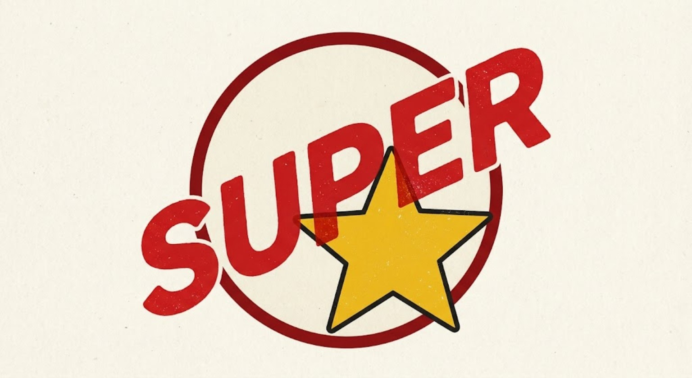
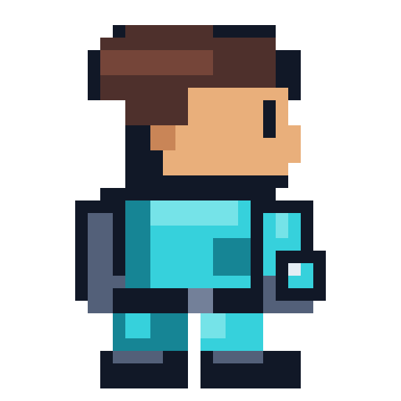
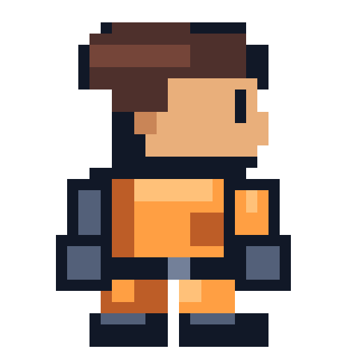
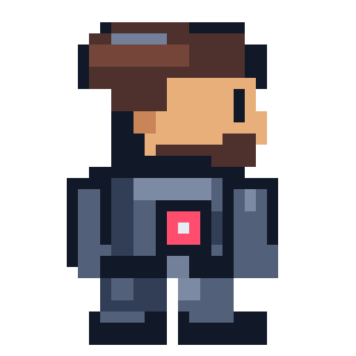
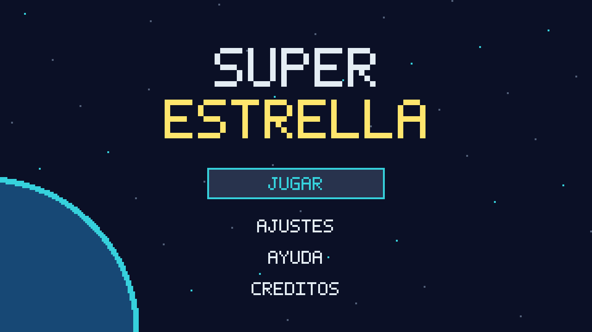
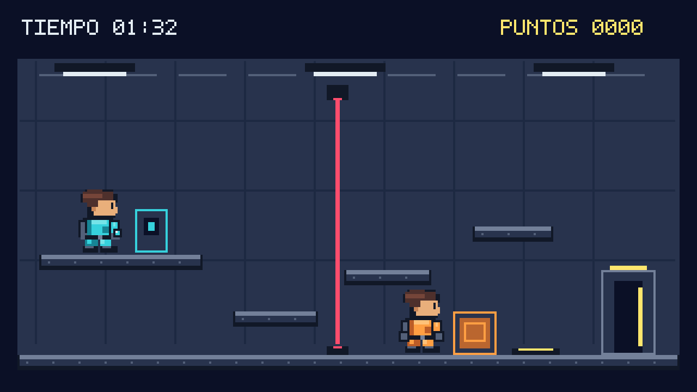
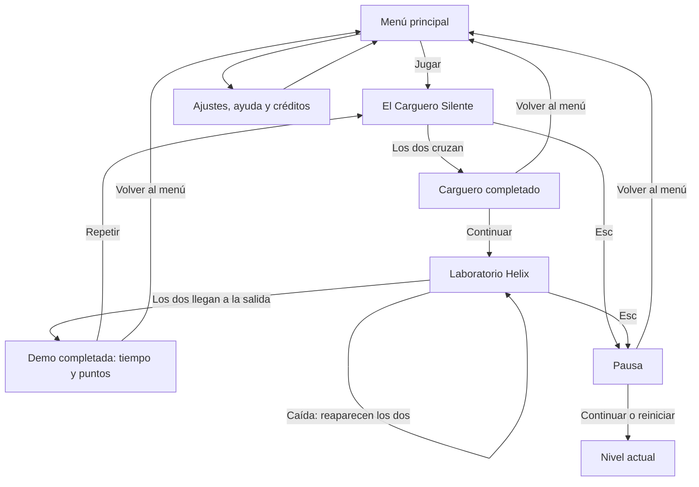

# Super Estrella - Documento de diseño del juego

[Volver al README](README.md)

**Juegos en Red · Grado en Diseño y Desarrollo de Videojuegos · URJC · Curso 2026/27**  
**Grupo J · Órbita Tres**  
**Versión del documento: Fase 2 · Demo local**

**Repositorio:** https://github.com/Yusuf062/super-estrella

| Nombre y apellidos | Correo universitario | GitHub |
| :--- | :--- | :--- |
| José Antonio Najarro Camacho | [ja.najarro.2024@alumnos.urjc.es](mailto:ja.najarro.2024@alumnos.urjc.es) | [Yusuf062](https://github.com/Yusuf062) |
| Víctor Martín Monterrubio | [v.martinm.2024@alumnos.urjc.es](mailto:v.martinm.2024@alumnos.urjc.es) | [VictorMM64](https://github.com/VictorMM64) |
| Daniel Heredia Naranjo | [d.heredia.2024@alumnos.urjc.es](mailto:d.heredia.2024@alumnos.urjc.es) | [DanHeredia](https://github.com/DanHeredia) |

## Índice

1. [Introducción](#1-introducción)
2. [Especificaciones básicas](#2-especificaciones-básicas)
3. [Jugabilidad](#3-jugabilidad)
4. [Narrativa](#4-narrativa)
5. [Imagen y diseño visual](#5-imagen-y-diseño-visual)
6. [Sonido](#6-sonido)
7. [Interfaz y diagrama de flujo](#7-interfaz-y-diagrama-de-flujo)
8. [Comunicación y marketing](#8-comunicación-y-marketing)
9. [Referencias](#9-referencias)

## 1. Introducción

**Super Estrella** es un juego cooperativo de plataformas y puzles en 2D. Izan y Gael siguen una señal por varias naves espaciales para encontrar a su padre, el comandante Oris. Izan activa terminales y Gael empuja cajas pesadas. Los dos deben coordinarse y alcanzar juntos la salida.

La **demo de la Fase 2** funciona en local e incluye **El Carguero Silente** y **Laboratorio Helix**. La Vigilia y el rescate de Oris forman parte del diseño de la aventura completa.

## 2. Especificaciones básicas

| Aspecto | Descripción |
| :--- | :--- |
| Título | Super Estrella |
| Género | Plataformas y puzles cooperativos |
| Jugadores | Dos, con acciones simultáneas y cooperación en tiempo real |
| Público objetivo | Jugadores de 10 años en adelante interesados en jugar con amigos o familiares |
| Plataforma | Navegador web para ordenador |
| Tecnología de la demo | HTML, CSS, JavaScript y Canvas 2D |
| Representación | 2D, vista lateral |
| Alcance de la Fase 2 | Dos niveles cortos, con una sala jugable por nivel |
| Idioma | Castellano |
| Licencia del código | Apache 2.0 |

La demo se abre desde `index.html` en el navegador. Dos jugadores comparten teclado y usan el ratón para los menús. La conexión mediante API REST y WebSockets queda para las siguientes fases.

## 3. Jugabilidad

### 3.1. Objetivo y ciclo de juego

En el Carguero, los hermanos combinan sus habilidades para desbloquear la compuerta. En Helix, cruzan un hueco y llegan a una salida elevada. En los dos niveles deben llegar juntos a la salida. Al completar Helix se muestran el tiempo y los puntos de la demo.

### 3.2. Controles

| Acción | Izan | Gael |
| :--- | :---: | :---: |
| Moverse | `A` y `D` | Flechas izquierda y derecha |
| Saltar | `W` | Flecha arriba |
| Interactuar | `E` junto al terminal | Mantener `Intro` y andar hacia la caja |
| Reiniciar sala | Botón de la interfaz | Botón de la interfaz |
| Abrir pausa | `Esc` | `Esc` |

Estos son los controles por defecto. En Ajustes se pueden cambiar las teclas de ambos personajes, restaurar las originales y ocultar o mostrar el recordatorio bajo la pantalla.

### 3.3. Mecánicas principales

- **Izan:** se acerca al terminal de la primera plataforma y lo activa. El terminal queda encendido hasta reiniciar el Carguero.
- **Gael:** empuja la caja manteniendo la tecla de interacción y moviéndose hacia ella.
- **Placa de presión:** se activa mientras tiene una caja o un personaje encima. La compuerta requiere también el terminal encendido. Dejar la caja sobre la placa permite que pasen los dos.
- **Plataforma móvil:** va de un lado al otro del hueco de Helix y transporta a quienes están apoyados en ella.
- **Gravedad reducida:** en la zona violeta de Helix, los personajes saltan más alto y caen más despacio.
- **Caída y reaparición:** si uno cae al vacío en Helix, los dos reaparecen al principio de ese nivel. El tiempo acumulado se mantiene.

### 3.4. Físicas y dificultad

Los personajes tienen gravedad, salto y colisiones con suelos, plataformas y objetos. La caja del Carguero se desplaza horizontalmente sobre el suelo. En Helix, los personajes pueden saltar desde abajo a la plataforma móvil y al balcón de salida. El primer nivel presenta un puzle de coordinación; el segundo añade saltos con una plataforma en movimiento y una zona de gravedad reducida.

### 3.5. Niveles y escenarios

| Nivel | Estado | Contenido |
| :--- | :--- | :--- |
| El Carguero Silente | Jugable en Fase 2 | Terminal, caja, placa de presión y compuerta compartida. Al salir, los hermanos reciben una señal que apunta a Helix. |
| Laboratorio Helix | Jugable en Fase 2 | Plataforma móvil, hueco y zona de gravedad reducida. Al salir, los hermanos descubren qué ocurrió con Oris y concluye la demo. |
| La Vigilia | Diseño de la aventura completa | Nave capitana con láseres temporizados y el puzle de rescate de Oris. |

### 3.6. Enfrentamiento final previsto

En la aventura completa, Oris permanece conectado al núcleo de la nave. Para liberarlo, los hermanos deben desactivar tres mecanismos: Gael coloca cajas sobre placas que permiten acceder a los terminales de Izan, mientras ambos esquivan láseres con patrones repetitivos.

Cada mecanismo desactivado queda registrado como punto de control. Al completar los tres se apaga el núcleo y ambos ganan. No se necesita un sistema de armas o ataques de los protagonistas.

### 3.7. Puntuación

La puntuación es conjunta. Cada nivel completado suma **1.000 puntos**. Cada caída en Helix resta **50 puntos**, con un mínimo de cero. El tiempo y la puntuación se mantienen al pasar del Carguero a Helix. Al final de la demo se puede repetir desde el primer nivel o volver al menú.

## 4. Narrativa

### 4.1. Historia

El comandante Oris desapareció durante una expedición que investigaba la energía Eclipse. Sus hijos crecieron creyendo que había muerto, hasta que reciben una transmisión con una frase que solo conocía su familia.

Izan y Gael siguen la señal por una flota. Al principio creen que su padre se ha convertido en su comandante enemigo, pero los mensajes encontrados entre niveles revelan que está conectado a un sistema que altera su voluntad.

La demo muestra el avance de la historia con textos breves en las pantallas de resultado. En la aventura completa, los hermanos llegarían al puente de mando, desactivarían el núcleo y liberarían a Oris.

### 4.2. Personajes

| Personaje | Personalidad, motivación y evolución |
| :--- | :--- |
| Izan, 20 años | Prudente y observador. Quiere descubrir la verdad sobre Oris. Activa terminales y aprende a confiar en Gael. |
| Gael, 18 años | Impulsivo y protector. Quiere recuperar a su familia. Empuja cajas y aprende a actuar con paciencia. |
| Oris | Antiguo comandante y padre de los protagonistas. Intenta resistirse al sistema de control. Su rescate resuelve el conflicto familiar. |

Las habilidades distintas de los hermanos refuerzan la necesidad de ayudarse.

## 5. Imagen y diseño visual

### 5.1. Logotipo

  

El logotipo utiliza letras rojas inclinadas con la palabra «SUPER», un aro rojo y una estrella amarilla sobre fondo crema. La estrella relaciona el nombre con la ambientación espacial.

### 5.2. Aspectos técnicos

- **Cámara:** representación lateral en 2D, con cámara fija que muestra toda la sala.
- **Resolución:** Canvas de 320 × 180 píxeles, escalado sin suavizado y con proporción 16:9.
- **Personajes:** sprites dibujados a 32 × 32 píxeles que cambian de orientación según el movimiento.

### 5.3. Estilo visual y colores

El juego utilizará arte de píxeles sencillo, con formas claras y una estética espacial. Los colores servirán para diferenciar a los personajes y reconocer los elementos importantes del escenario.

- Los fondos de las naves tendrán tonos azules oscuros y grises, para que las plataformas y objetos destaquen sobre la decoración.
- Izan y los terminales utilizarán tonos cian; Gael y las cajas, tonos naranjas. Así se identificará qué personaje puede interactuar con cada elemento.
- Las salidas y la placa destacan en amarillo. El violeta identifica la zona de gravedad reducida de Helix.
- Se podrán utilizar tonos más claros u oscuros para luces y sombras, además de colores de piel, pelo y detalles. Las formas e iconos complementarán el uso de colores.

### 5.4. Inspiración y bocetos

**Fireboy and Watergirl** inspira los puzles con habilidades complementarias y salas compartidas [1]. **Star Wars** sirve como referencia para la aventura espacial y el conflicto familiar, con personajes y escenarios propios [2].

Los siguientes bocetos digitales muestran los hermanos, el padre, el menú y una sala de ejemplo. Sus formas y colores se colocan sobre una cuadrícula de píxeles uniforme. Son referencias visuales de la Fase 1. La demo reutiliza los sprites de los hermanos y la imagen del menú principal. El boceto de sala incluye un láser como referencia para la aventura completa.

#### Personajes

#### Menú principal

#### Sala de juego

La sala ilustra las plataformas, el terminal de Izan, la caja de Gael, una placa de presión, un láser y la salida compartida.

## 6. Sonido

La demo usa dos temas distintos en bucle: **Out in Space Menu** para el menú y **Out in Space** durante la partida. Ambos son de Agecaf y están disponibles bajo licencia CC0 en [OpenGameArt](https://opengameart.org/content/out-in-space-0).

Hay efectos de salto, activación del terminal y apertura o cierre de la compuerta. Desde Ajustes se regula por separado el volumen de música y efectos. Para oír la música antes de iniciar la partida, se pulsa **Activar sonido** en el menú.

## 7. Interfaz y diagrama de flujo

### 7.1. Pantallas

- **Menú principal:** Jugar, Ajustes, Ayuda y Créditos.
- **Partida:** cámara fija, tiempo, puntos e indicaciones del objetivo.
- **Pausa:** continuar, reiniciar el nivel actual o volver al menú.
- **Resultados:** al completar el Carguero se puede continuar a Helix. Al completar Helix se puede repetir la demo o volver al menú. Ambas pantallas muestran el tiempo y los puntos acumulados.
- **Ajustes:** volumen de música y efectos, teclas por personaje y visibilidad de los controles.
- **Ayuda y créditos:** controles vigentes, objetivo y autores.

### 7.2. Diagrama de flujo

## 8. Comunicación y marketing

El mensaje principal será **«Dos hermanos. Una señal. Un viaje juntos.»** La promoción se dirigirá a personas que disfrutan resolviendo retos con un amigo.

Se compartirán capturas y vídeos cortos de puzles cooperativos en redes sociales. La página del juego explicará las habilidades, los controles y cómo jugar. En la fase de publicación se prevé distribuir la versión local en itch.io, Newgrounds y Game Jolt.

## 9. Referencias

[1] *Fireboy and Watergirl*. Serie de videojuegos. Referencia de cooperación asimétrica y diseño de salas.

[2] *Star Wars*. Saga cinematográfica de Lucasfilm. Referencia de ambientación espacial y conflicto familiar.

[3] Agecaf. [*Out in Space*](https://opengameart.org/content/out-in-space-0). Música del menú y de la partida, licencia CC0.
