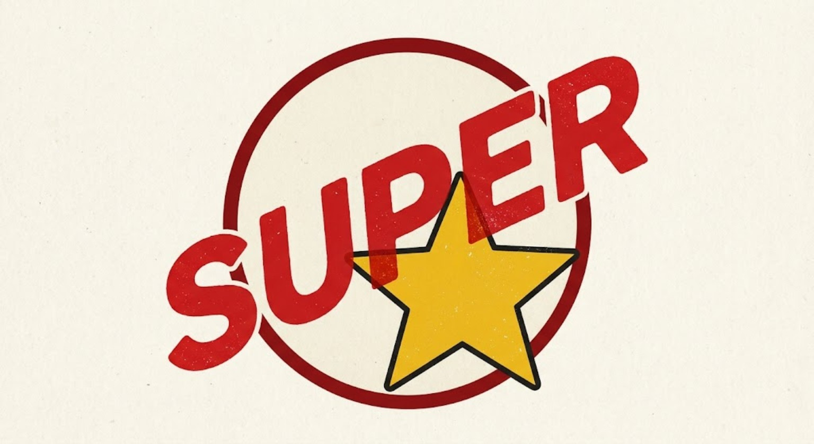
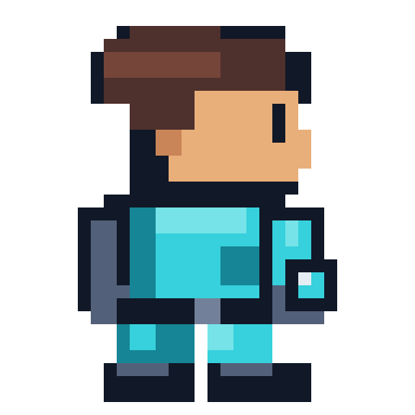
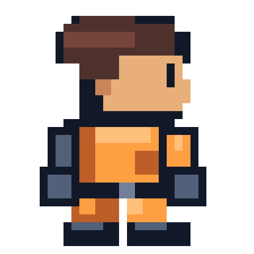
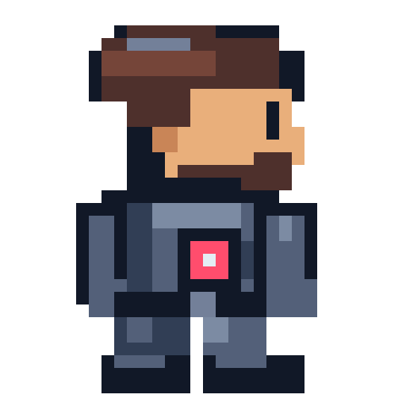
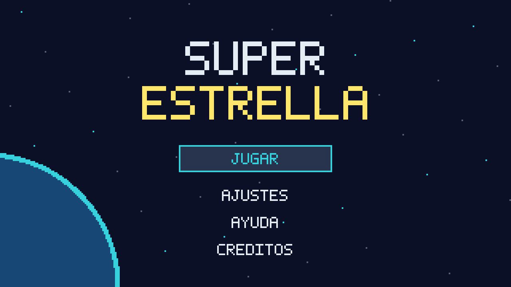
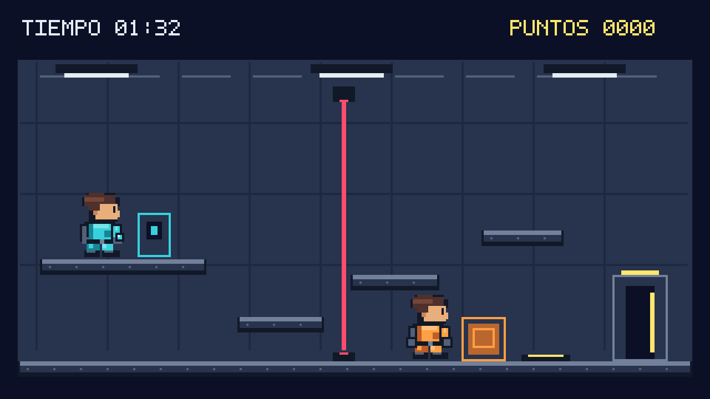
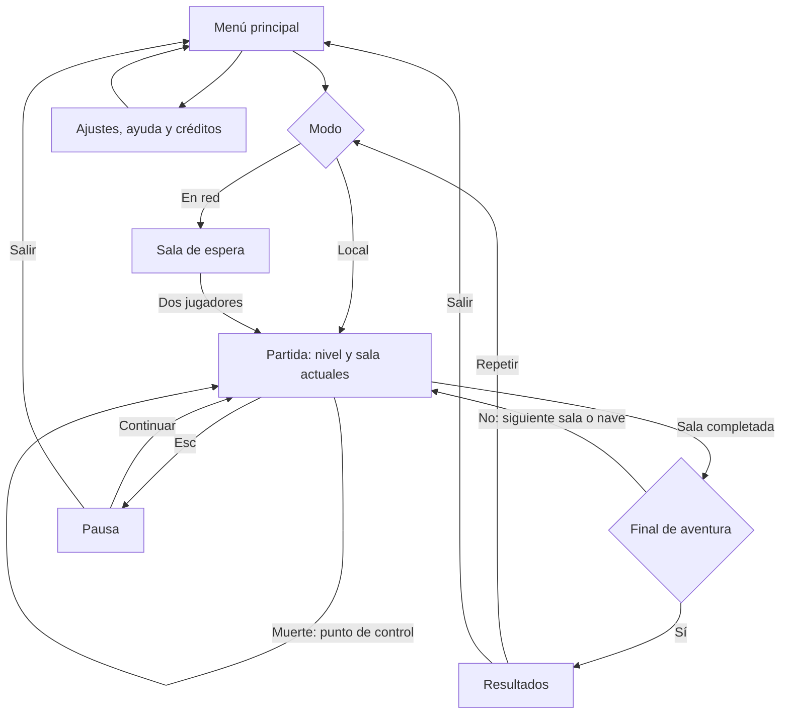

# Super Estrella - Documento de diseño del juego

[Volver al README](README.md)

**Juegos en Red · Grado en Diseño y Desarrollo de Videojuegos · URJC · Curso 2026/27**  
**Grupo J · Órbita Tres**

**Repositorio:** https://github.com/Yusuf062/super-estrella

| Nombre y apellidos | Correo universitario | GitHub |
| :--- | :--- | :--- |
| José Antonio Najarro Camacho | [ja.najarro.2024@alumnos.urjc.es](mailto:ja.najarro.2024@alumnos.urjc.es) | [Yusuf062](https://github.com/Yusuf062) |
| Víctor Martín Monterrubio | Pendiente de añadir | [VictorMM64](https://github.com/VictorMM64) |
| Daniel Heredia Naranjo | [d.heredia.2024@alumnos.urjc.es](mailto:d.heredia.2024@alumnos.urjc.es) | [DanHeredia](https://github.com/DanHeredia) |

## Índice

1. [Introducción](#1-introducción)
2. [Especificaciones básicas](#2-especificaciones-básicas)
3. [Jugabilidad](#3-jugabilidad)
4. [Narrativa](#4-narrativa)
5. [Imagen y diseño visual](#5-imagen-y-diseño-visual)
6. [Sonido](#6-sonido)
7. [Interfaz y diagrama de flujo](#7-interfaz-y-diagrama-de-flujo)
8. [Comunicación y marketing](#8-comunicación-y-marketing)
9. [Referencias](#9-referencias)

## 1. Introducción

**Super Estrella** es un juego cooperativo de plataformas y puzles en 2D. Dos jugadores controlan a los hermanos Izan y Gael, que recorren tres naves espaciales para encontrar a su padre, el comandante Oris.

Izan activa terminales tecnológicos y Gael empuja cajas pesadas. Deben combinar sus habilidades para abrir puertas, superar obstáculos y alcanzar juntos la salida. La aventura termina con un enfrentamiento contra su padre, planteado como un puzle cooperativo que utiliza las mecánicas aprendidas durante los niveles.

La cooperación es el centro del juego: ninguno de los hermanos puede completar los niveles solo. Se plantea una aventura corta y viable para un equipo de tres integrantes.

## 2. Especificaciones básicas

| Aspecto | Descripción |
| :--- | :--- |
| Título | Super Estrella |
| Género | Plataformas y puzles cooperativos |
| Jugadores | Dos, con acciones simultáneas y cooperación en tiempo real |
| Público objetivo | Jugadores de 10 años en adelante interesados en jugar con amigos o familiares |
| Plataforma | Navegador web para ordenador |
| Tecnología prevista | Phaser 3, HTML, CSS y JavaScript |
| Representación | 2D, vista lateral |
| Alcance | Tres niveles cortos; el enfrentamiento final forma parte del tercero |
| Duración | Se ajustará mediante pruebas de resolución de los puzles |
| Idioma | Castellano |
| Licencia del código | Apache 2.0 |

Primero se desarrollará una versión local para dos jugadores en el mismo teclado. En las fases siguientes se incorporarán la comunicación mediante API REST y el juego desde dos ordenadores mediante WebSockets.

## 3. Jugabilidad

### 3.1. Objetivo y ciclo de juego

Los jugadores deben resolver los puzles de cada sala y llegar juntos a la compuerta de salida. La progresión es lineal: completan una nave y pasan a la siguiente. Ganan de forma conjunta al desactivar el sistema que controla a Oris.

En cada sala observan los obstáculos, reparten las acciones según las habilidades de sus personajes y ejecutan el puzle para abrir el camino. Un hermano debe facilitar el paso del otro, combinando saltos e interacciones.

### 3.2. Controles

| Acción | Jugador 1 / cada cliente en red | Jugador 2 en modo local |
| :--- | :---: | :---: |
| Moverse | `A` y `D` | Flechas izquierda y derecha |
| Saltar | `W` | Flecha arriba |
| Interactuar | `E` | `Intro` |
| Reiniciar sala | Botón de la interfaz | Botón de la interfaz |
| Abrir pausa | `Esc` | `Esc` |

El ratón se utiliza para los botones de menús, ajustes y resultados. En red, cada jugador controla únicamente a su personaje.

### 3.3. Mecánicas principales

- **Movimiento:** desplazamiento horizontal y salto sobre plataformas fijas o móviles.
- **Izan:** activa terminales para abrir determinadas puertas o desactivar láseres.
- **Gael:** empuja cajas pesadas manteniendo la interacción y moviéndose hacia ellas.
- **Placas de presión:** permanecen activas mientras un personaje o una caja está encima. Algunas puertas requieren dos placas activas a la vez.
- **Gravedad reducida:** las zonas señalizadas permiten saltar más alto y caer más despacio. Afectan a los personajes, no a las cajas.
- **Peligros:** tocar un láser o caer al vacío hace que ambos reaparezcan en el último punto de control.
- **Puntos de control:** se activan al completar determinadas salas. Al reaparecer se restablecen las cajas y mecanismos del tramo para evitar bloqueos.
- **Salida compartida:** solo permite avanzar cuando están presentes ambos hermanos.

### 3.4. Físicas y dificultad

Se utilizarán gravedad, salto y colisiones con suelos, paredes y objetos. Las cajas se desplazarán horizontalmente y caerán sobre las superficies. Las plataformas móviles seguirán rutas fijas y transportarán a los personajes.

La dificultad aumenta al combinar mecanismos conocidos: abrir una puerta, mantener una placa con una caja y coordinar esas acciones mientras se esquivan peligros. La gravedad reducida modifica los saltos sin añadir controles nuevos. Los láseres temporizados mostrarán una señal antes de activarse.

### 3.5. Niveles y escenarios

| Nivel | Escenario y contenido |
| :--- | :--- |
| 1. El Carguero Silente | Almacén espacial. Introduce saltos, terminales, cajas y puertas. Los hermanos reciben una señal de Oris. |
| 2. Laboratorio Helix | Laboratorio con plataformas móviles y zonas de gravedad reducida. Descubren que su padre está conectado a un sistema de control. |
| 3. La Vigilia | Nave capitana. Combina las mecánicas anteriores con láseres y termina con el rescate de Oris en el puente de mando. |

Cada nivel tendrá pocas salas, con cámara fija y distribución legible. Las cajas necesarias no se colocarán junto a zonas donde puedan perderse sin posibilidad de reinicio.

**Ejemplo de puzle:** Gael coloca una caja sobre una placa para que Izan cruce una puerta. Desde el otro lado, Izan activa un terminal que permite pasar a Gael. Ambos alcanzan juntos la salida.

### 3.6. Enfrentamiento final

Oris permanece conectado al núcleo de la nave. Para liberarlo, los hermanos deben desactivar tres mecanismos: Gael coloca cajas sobre placas que permiten acceder a los terminales de Izan, mientras ambos esquivan láseres con patrones repetitivos.

Cada mecanismo desactivado queda registrado como punto de control. Al completar los tres se apaga el núcleo y ambos ganan. No se necesita un sistema de armas o ataques de los protagonistas.

### 3.7. Puntuación

La puntuación es conjunta: 1.000 puntos por completar cada nivel y una penalización de 50 por cada reinicio debido a una muerte, sin bajar de cero. Los resultados muestran el tiempo total y los puntos, permitiendo repetir la aventura para mejorar.

## 4. Narrativa

### 4.1. Historia

El comandante Oris desapareció durante una expedición que investigaba la energía Eclipse. Sus hijos crecieron creyendo que había muerto, hasta que reciben una transmisión con una frase que solo conocía su familia.

Izan y Gael siguen la señal por una flota. Al principio creen que su padre se ha convertido en su comandante enemigo, pero los mensajes encontrados entre niveles revelan que está conectado a un sistema que altera su voluntad.

Al llegar al puente de mando, Oris intenta impedirles el paso. Los hermanos desactivan el núcleo, lo liberan y escapan juntos. La historia se presenta mediante textos breves al comenzar o terminar cada nivel, sin escenas cinematográficas complejas ni voces grabadas.

### 4.2. Personajes

| Personaje | Personalidad, motivación y evolución |
| :--- | :--- |
| Izan, 20 años | Prudente y observador. Quiere descubrir la verdad sobre Oris. Activa terminales y aprende a confiar en Gael. |
| Gael, 18 años | Impulsivo y protector. Quiere recuperar a su familia. Empuja cajas y aprende a actuar con paciencia. |
| Oris | Antiguo comandante y padre de los protagonistas. Intenta resistirse al sistema de control. Su rescate resuelve el conflicto familiar. |

Los rasgos de los hermanos se reflejan en pequeños intercambios de diálogo y en la necesidad de ayudarse.

## 5. Imagen y diseño visual

### 5.1. Logotipo

  

El logotipo utiliza letras rojas inclinadas con la palabra «SUPER», un aro rojo y una estrella amarilla sobre fondo crema. La estrella relaciona el nombre con la ambientación espacial.

### 5.2. Estilo, cámara y colores

Se empleará arte de píxeles sencillo, con personajes sobre una cuadrícula aproximada de 32 x 32 píxeles y animaciones breves. La representación será lateral en 2D, con **cámara fija por sala**, sin desplazamiento ni ampliación dinámica. La resolución base prevista es 1280 x 720, adaptada proporcionalmente a la ventana.

| Elemento | Color | Función |
| :--- | :---: | :--- |
| Fondo | `#0B1026` | Espacio y profundidad |
| Estructura | `#28334D` | Suelos y paredes metálicas |
| Izan y terminales | `#36D1DC` | Interacciones tecnológicas |
| Gael y cajas | `#FF9F43` | Interacciones físicas |
| Peligros | `#FF4D6D` | Láseres y avisos |
| Objetivos | `#FFE66D` | Salidas y puntos de control |

Los elementos también se distinguirán por formas e iconos. Las plataformas utilizables destacarán frente a los fondos decorativos.

### 5.3. Inspiración y bocetos

**Fireboy and Watergirl** inspira los puzles con habilidades complementarias y salas compartidas [1]. **Star Wars** sirve como referencia para la aventura espacial y el conflicto familiar, con personajes y escenarios propios [2].

Los bocetos mostrarán los dos hermanos y al padre, el menú principal y una sala de juego con plataformas, cajas, terminales y salida. La pantalla de juego permitirá entender tanto la interfaz como un ejemplo de cooperación.

**Pendiente antes de la entrega:** incorporar los bocetos de personajes, menú y pantalla de juego.

<!-- Descomentar cada imagen cuando se suba el archivo correspondiente a img/. -->
<!--  -->
<!--  -->
<!--  -->
<!--  -->
<!--  -->

## 6. Sonido

La música del menú será electrónica y tranquila, con ambiente espacial. En los niveles se utilizará una pista ambiental suave y en el enfrentamiento final una más intensa. Un sonido breve indicará la victoria.

Los efectos cubrirán saltos, empuje de cajas, terminales, placas, puertas, muerte y botones de interfaz. Los avisos importantes tendrán una señal visual equivalente. Los ajustes permitirán modificar por separado música y efectos.

Se utilizarán recursos propios o de terceros con licencia compatible. Antes de incorporar cada recurso externo se registrarán su autor, enlace y licencia en los créditos.

## 7. Interfaz y diagrama de flujo

### 7.1. Pantallas

- **Menú:** logo y botones Jugar, Ajustes, Ayuda y Créditos. En las fases de red mostrará la conexión al servidor y los usuarios conectados.
- **Sala de espera:** en red, espera a dos jugadores con personajes diferentes. En local se comienza directamente.
- **Partida:** sala completa, personajes, tiempo, puntuación e indicaciones de interacción.
- **Pausa:** continuar o salir. En red se compartirá el estado de pausa entre ambos jugadores.
- **Resultados:** tiempo, puntos y botones Repetir y Menú.
- **Ayuda, ajustes y créditos:** controles y habilidades, volumen y autores respectivamente.

Si se desconecta un jugador, termina la partida y se informa al compañero. Si cae el servidor, se muestra un aviso que bloquea las acciones y comprueba la conexión hasta recuperarla.

### 7.2. Diagrama de flujo

Las desconexiones interrumpen este flujo y llevan al aviso correspondiente. El reinicio conserva el progreso anterior al último punto de control.

## 8. Comunicación y marketing

El mensaje principal será **«Dos hermanos. Una señal. Un viaje juntos.»** La promoción se dirigirá a personas que disfrutan resolviendo retos con un amigo.

Se compartirán capturas y vídeos cortos de puzles cooperativos en redes sociales. La página del juego explicará las habilidades, los controles y cómo jugar. En la fase de publicación se prevé distribuir la versión local en itch.io, Newgrounds y Game Jolt.

## 9. Referencias

[1] *Fireboy and Watergirl*. Serie de videojuegos. Referencia de cooperación asimétrica y diseño de salas.

[2] *Star Wars*. Saga cinematográfica de Lucasfilm. Referencia de ambientación espacial y conflicto familiar.

[3] Phaser Studio. *Documentación de Phaser*. https://docs.phaser.io/

[4] Enunciado de la práctica de *Juegos en Red*, URJC, y plantilla de entrega de la Fase 1 facilitada en el Aula Virtual.

Los recursos gráficos y sonoros externos se añadirán con sus atribuciones cuando se seleccionen.
