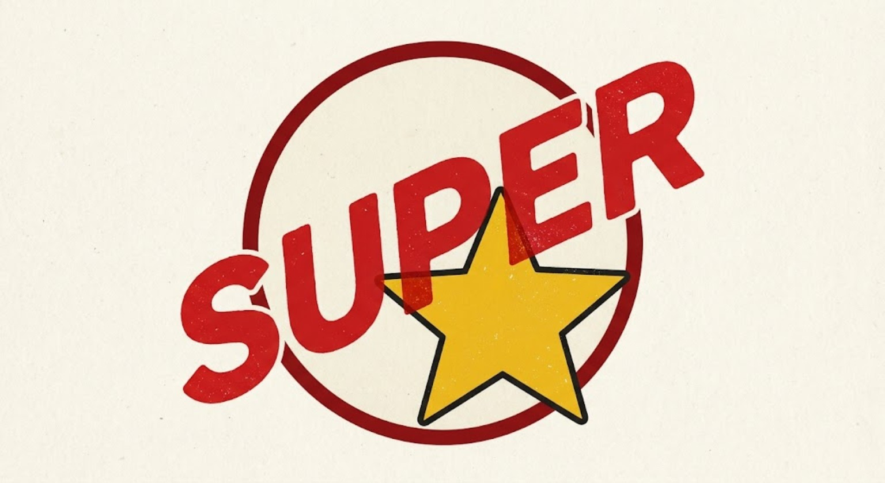

  

# Super Estrella

**Juegos en Red · Grado en Diseño y Desarrollo de Videojuegos · URJC · Curso 2026/27**

**Grupo J · Órbita Tres**

## Descripción del juego

**Super Estrella** es un juego cooperativo de plataformas y puzles en 2D. Los hermanos Izan y Gael siguen una señal por varias naves espaciales para averiguar qué le ocurrió a su padre, el comandante Oris.

## Demo local · Fase 2

La demo se juega entre **dos personas en el mismo ordenador y con un solo teclado**. Está hecha con HTML, CSS, JavaScript y Canvas 2D.

1. Descarga el repositorio desde **Code → Download ZIP** y descomprímelo.
2. Abre `index.html` en el navegador y pulsa **Jugar**. No hace falta instalar dependencias ni arrancar un servidor.
3. Si quieres oír la música del menú antes de jugar, pulsa **Activar sonido**.

| Acción | Izan | Gael |
| :--- | :---: | :---: |
| Moverse | `A` / `D` | `←` / `→` |
| Saltar | `W` | `↑` |
| Habilidad | `E` junto al terminal | Mantener `Intro` y andar hacia la caja |

**Esc** abre la pausa y permite reanudar la partida. Desde la pausa se puede reiniciar el nivel actual o volver al menú. En **Ajustes** se pueden cambiar las teclas, restaurar los controles originales y regular por separado el volumen de la música y los efectos.

- **El Carguero Silente:** Izan activa el terminal y Gael empuja una caja hasta la placa de presión. Con el terminal y la placa activos se abre la compuerta; los dos hermanos tienen que cruzarla.
- **Laboratorio Helix:** los dos usan una plataforma móvil para cruzar el hueco y aprovechan la zona violeta de gravedad reducida para alcanzar la salida elevada.

La demo termina en Helix con una pantalla de tiempo y puntos. Cada nivel completado suma **1.000 puntos**. Si uno cae en Helix, ambos reaparecen al inicio de ese nivel y pierden **50 puntos**, con un mínimo de cero.

## Equipo de desarrollo

| Nombre y apellidos | Correo universitario | GitHub |
| :--- | :--- | :--- |
| José Antonio Najarro Camacho | ja.najarro.2024@alumnos.urjc.es | [Yusuf062](https://github.com/Yusuf062) |
| Víctor Martín Monterrubio | v.martinm.2024@alumnos.urjc.es | [VictorMM64](https://github.com/VictorMM64) |
| Daniel Heredia Naranjo | d.heredia.2024@alumnos.urjc.es | [DanHeredia](https://github.com/DanHeredia) |

### Organización del trabajo

Las responsabilidades principales se distribuyen de la siguiente manera:

| Integrante | Responsabilidades |
| :--- | :--- |
| José Antonio Najarro Camacho | Diseño de jugabilidad: habilidades, controles, físicas, progresión y puntuación. Coordinación del GDD y organización del repositorio. |
| Víctor Martín Monterrubio | Diseño visual: bocetos de personajes, escenarios e interfaces, paleta de colores y preparación de recursos gráficos. |
| Daniel Heredia Naranjo | Diseño narrativo y de niveles: historia, personajes, puzles y enfrentamiento final. Propuesta sonora y estrategia de comunicación. |

El reparto orienta la organización del proyecto. Los tres integrantes participan en la revisión del diseño y en la preparación de la defensa.

## Documento de diseño

El concepto, las mecánicas, la narrativa y el diseño audiovisual se describen en el **[documento de diseño del juego (GDD)](GDD.md)**.

## Estado del proyecto

| Fase | Contenido | Estado |
| :--- | :--- | :--- |
| Fase 1 | Equipo, concepto y documento de diseño | Entregada |
| Fase 2 | Demo jugable en local: El Carguero Silente y Laboratorio Helix | Implementada |
| Fase 3 | Comunicación cliente-servidor mediante API REST | Pendiente |
| Fase 4 | Multijugador en tiempo real mediante WebSockets | Pendiente |

## Audio y licencia

**Música:** [Out in Space](https://opengameart.org/content/out-in-space-0), de Agecaf, bajo licencia CC0. Se utilizan `Out in Space Menu.ogg` para el menú y `Out in Space.ogg` para la partida.

La demo incluye efectos para el salto, el terminal y la compuerta. Los archivos de audio están en [`audio/`](audio/).

El código del proyecto se distribuye bajo la **[licencia Apache 2.0](LICENSE)**. Los recursos de terceros conservan sus propias licencias.
